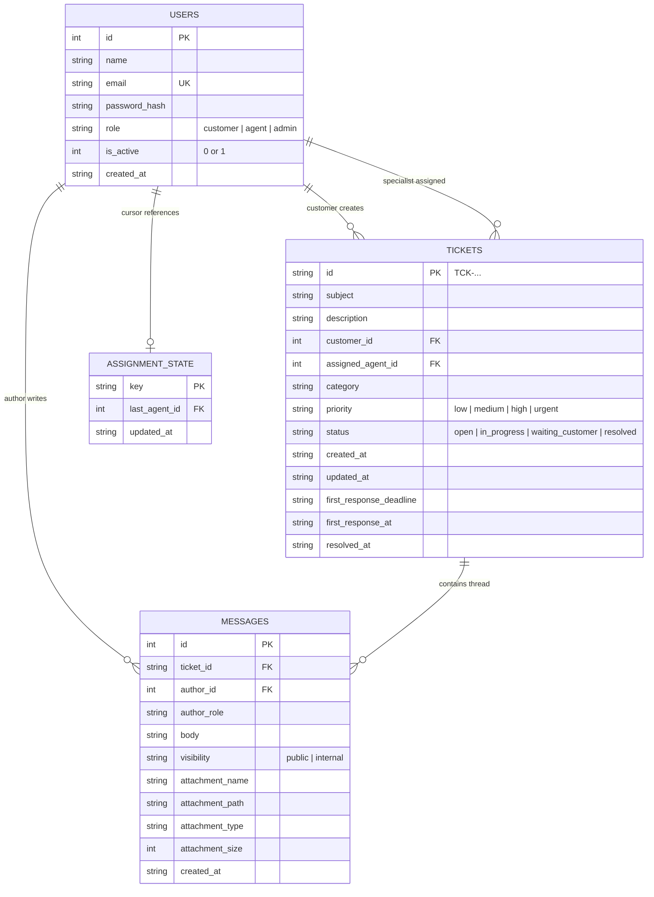

# ResolveAI — Intelligent Support Desk

ResolveAI is a production-quality, responsive, and secure customer support desk platform designed for modern SaaS organizations. It combines deterministic business logic (round-robin agent dispatch, persistent 4-hour SLA calculations, strict RBAC, and zero-leakage internal notes) with advisory Google Gemini AI assistance (automated ticket categorization and editable response drafts).

Built for technical evaluations, portfolio demonstrations, and production deployments.

---

## 🌟 Executive Summary & Business Problem

Customer support teams face three major operational bottlenecks:
1. **Slow First-Response Times & Inconsistent SLAs**: Manual ticket triaging leads to uneven agent workloads and missed service-level agreement (SLA) deadlines.
2. **Staff Confidentiality & Accidental Data Leakage**: Support agents need private scratchpads to discuss technical root causes, billing exceptions, or backend error traces without exposing them to customers.
3. **Repetitive Draft Writing**: Agents spend excessive time re-typing standard troubleshooting and confirmation replies instead of addressing complex customer inquiries.

**ResolveAI solves these problems by providing:**
- A **transactional round-robin dispatcher** that deterministically balances ticket loads across active agents and skips agents on leave.
- A **persistent SLA monitoring engine** that highlights approaching deadlines in amber and overdue breaches in red, stopping the timer strictly on qualifying public replies.
- **Query-level isolation for staff notes**, ensuring internal communications never reach customer clients or customer-facing AI prompts.
- **Gracefully degrading Gemini AI tools** that suggest ticket categories and draft professional responses without ever exposing API keys or sending unapproved messages.

---

## 📸 Visual Overview & Architecture

### System Architecture Diagram

```
+-----------------------------------------------------------------------------------+
|                                 CLIENT (Vite + React)                             |
|  - Customer Portal: Ticket Submission, Public Conversation Thread, Reopen Support |
|  - Specialist Workspace: Prioritized Queue, AI Reply Cockpit, Staff Notes Mode     |
|  - Admin Dashboard: Executive KPIs, Recharts Analytics, Staff Roster Control      |
+------------------------------------------+----------------------------------------+
                                           | HTTP-Only JWT Cookie / JSON REST / Multipart
                                           v
+-----------------------------------------------------------------------------------+
|                             BACKEND API (Node.js + Express)                       |
|  [Security Layer] Helmet | Rate Limiting | CORS | Cookie Parser | Zod Validation  |
|  [Auth Middleware] JWT Verify | Role Guard ('customer' | 'agent' | 'admin')       |
|  [Controllers] Auth Controller | Ticket Controller | Admin Analytics Controller    |
+---------------------+-------------------------------+-----------------------------+
                      |                               |
                      v                               v
+-----------------------------------+   +-------------------------------------------+
|    PERSISTENT RELATIONAL DB       |   |             AI SERVICE LAYER              |
|        (SQLite Engine)            |   |          (Official Gemini SDK)            |
|  - users (bcrypt hashed passwords)|   |  - gemini-1.5-flash                       |
|  - tickets (UTC timestamps, SLA)  |   |  - Structured JSON category classification|
|  - messages (public / internal)   |   |  - Public conversation response drafts    |
|  - assignment_state (atomic cursor|   |  - Graceful degradation on failure        |
+-----------------------------------+   +-------------------------------------------+
```

---

## 🛠️ Technology Stack

| Layer | Technology | Details & Justification |
|---|---|---|
| **Frontend** | React 18, Vite | Single-page application with instant client routing and optimized bundling |
| **Styling** | Tailwind CSS | SaaS light theme: soft-gray canvas, deep navy text, indigo brand accents |
| **Icons** | Lucide React | Clean, accessible SVG iconography |
| **Data Viz** | Recharts | Responsive SVG charts for category distributions, priorities, and volume trends |
| **HTTP Client**| Axios | Configured with `withCredentials: true` for automatic cookie management |
| **Backend** | Node.js, Express.js | Modular ES modules REST architecture |
| **Database** | SQLite via Node.js Engine | ACID-compliant, persistent relational database with immediate write transactions |
| **Validation** | Zod | Server-side runtime validation for body, params, query strings, and uploads |
| **Security** | Helmet, bcrypt, jsonwebtoken, express-rate-limit | Strict security headers, bcrypt hashing (10 salt rounds), JWT HTTP-only cookies |
| **File Storage**| Multer | Strict file upload security with randomized filenames, 5MB limit, and MIME allowlist |
| **AI Integration**| `@google/generative-ai` | Official Google Gemini SDK with strict timeout handling and fallback defaults |
| **Testing** | Vitest, Supertest | Fast unit and integration tests executing against an isolated test database |

---

## 🏛️ Database Schema & Key Design Decisions

The database design strictly enforces relational integrity, foreign key cascades, and performance indexing.



### Key Design Decisions
1. **Single Source of Truth for SLA State**: SLA compliance is never computed client-side. The database records `created_at`, `first_response_deadline`, and `first_response_at` as ISO 8601 UTC strings. Dynamic states (`within_sla`, `approaching`, `overdue`, `met`, `breached_responded`) are deterministically derived by comparing persisted timestamps against current UTC time.
2. **Atomic Write Locking for Round-Robin**: Round-robin assignment runs inside an immediate SQLite transaction (`BEGIN IMMEDIATE`). This guarantees that concurrent ticket submissions cannot interleave or read stale cursor values.
3. **Database-Level Isolation for Internal Notes**: Customer endpoints execute `SELECT ... WHERE visibility = 'public'`. Internal staff notes are never transferred to the customer's browser, preventing inspection via browser developer tools or JSON inspection.

---

## ⚡ Round-Robin Assignment Logic

When a customer submits a ticket:
1. The server opens an immediate transaction (`BEGIN IMMEDIATE`).
2. It queries active agents sorted deterministically by ID:
   ```sql
   SELECT id, name, email FROM users WHERE role = 'agent' AND is_active = 1 ORDER BY id ASC;
   ```
3. **Inactive Agent Handling**: If an agent is on leave (`is_active = 0`), they are excluded from the candidate list.
4. **Empty Pool Handling**: If no active agents are configured, the ticket is created with `assigned_agent_id = NULL` and placed in the unassigned queue.
5. **Cursor Advancement**:
   - The server queries `assignment_state` for `last_agent_id`.
   - It computes the next agent index using modular arithmetic: `(currentIndex + 1) % activeAgents.length`.
   - If the previous agent was deactivated or deleted, it gracefully wraps to the first active agent (`index = 0`).
   - The cursor is updated and the ticket is persisted in the same transaction.

---

## ⏱️ SLA Engine & Timer Rules

1. **Configurable SLA Window**: Default of 4 calendar hours (`SLA_HOURS=4`).
2. **UTC Calculation**: Deadlines are computed at ticket creation:
   $$\text{Deadline} = \text{Created Timestamp} + (\text{SLA\_HOURS} \times 3,600,000 \text{ ms})$$
3. **Visual Urgency Indicators**:
   - **Within SLA**: Blue badge indicating time remaining.
   - **Approaching Deadline**: Amber badge when less than 1 hour remains.
   - **Overdue**: Red alert badge when the deadline has elapsed without a public response.
4. **First-Response Timer Stoppage**:
   - The timer stops **only** when the first qualifying **public** staff reply is persisted.
   - **Internal notes never stop the first-response timer.**
   - Subsequent replies do not alter `first_response_at`.
5. **Average Response Time Metric**:
   - Calculated by subtracting `created_at` from `first_response_at`.
   - Unresponded tickets are excluded from the average calculation to prevent skewed performance figures.

---

## 🔒 Security Architecture & Privacy Safeguards

- **Password Security**: Passwords hashed using `bcrypt` (10 salt rounds) and never stored in plaintext or logged.
- **HTTP-Only Cookies**: JWT tokens stored in HTTP-only, `SameSite=Lax` cookies with secure flag support for HTTPS.
- **Client Input Sanitization**: Client-supplied `customer_id` parameters are ignored during ticket creation; ownership is always bound to the authenticated user from the verified JWT.
- **Internal Note Privacy**:
  - Customers cannot read internal notes (query filtered).
  - Customers cannot create internal notes (rejected with `403 Forbidden`).
  - Customers cannot download attachments belonging to internal notes (rejected with `403 Forbidden`).
  - AI prompt payloads strictly exclude internal notes.
- **File Upload Protection**:
  - Randomized storage filenames: `${Date.now()}-${randomBytes(8)}${ext}`.
  - Path traversal protection using `path.basename`.
  - File size cap (5MB) and strict MIME type allowlist (PNG, JPEG, WEBP, PDF, TXT).
- **Rate Limiting**: Express rate limiting applied globally and with tighter thresholds on login endpoints to defend against brute force attempts.

---

## 🤖 Google Gemini AI Integration

### 1. Advisory Category Detection
- Analyzes untrusted ticket subjects and descriptions against controlled categories (*Technical Issue*, *Billing and Payments*, *Account Access*, *Feature Request*, *Bug Report*, *General Inquiry*).
- System prompt isolates user text within delimiters to protect against prompt injection.
- Employs a 6-second timeout promise.
- If Gemini is unreachable or disabled, defaults to `"General Inquiry"`. Ticket creation never fails.

### 2. Specialist Response Drafting
- Agents can click **"Generate AI Draft"** in the ticket detail view.
- Injects ticket subject, description, and **public messages only** into Gemini (`gemini-1.5-flash`).
- Returns draft into an editable textarea.
- **Never sends automatically**: Requires explicit human agent review and a click on **"Send Public Reply"**.

---

## 👥 Seed Data & Demo Accounts

> [!IMPORTANT]
> The following credentials are provided for local development and assessment evaluation only. Change default secrets before production deployment.

| Role | Name | Email Address | Password | Purpose |
|---|---|---|---|---|
| **Administrator** | Alex Mercer | `admin@resolveai.com` | `Password123!` | Executive KPIs, agent workload, staff management |
| **Senior Specialist** | Sarah Connor | `sarah.agent@resolveai.com` | `Password123!` | Queue triage, AI reply generation, staff notes |
| **Support Specialist**| David Miller | `david.agent@resolveai.com` | `Password123!` | Active round-robin queue recipient |
| **Technical Specialist**| Elena Rostova | `elena.agent@resolveai.com` | `Password123!` | Technical issue triage and resolution |
| **Inactive Specialist** | Marcus Vance | `marcus.agent@resolveai.com` | `Password123!` | Demonstrates skipping inactive agents |
| **Customer 1** | John Doe | `john.doe@acmecorp.com` | `Password123!` | Enterprise customer with active & overdue tickets |
| **Customer 2** | Emma Watson | `emma.watson@globex.io` | `Password123!` | Customer with resolved tickets & reopen flows |
| **Customer 3** | Liam Chen | `liam.chen@techstartup.co` | `Password123!` | Customer with urgent API/technical inquiries |

*(Note: The login page includes 1-click demo fill buttons for immediate testing).*

---

## 🚀 Local Installation & Setup

### Prerequisites
- Node.js (v20+, v22+, or v25+)
- npm (v10+ or v11+)

### 1. Clone & Setup Environment
```bash
git clone https://github.com/AyushGupta205/-resolveai.git
cd ./-resolveai
```

Copy the environment example file:
```bash
# On Windows PowerShell:
Copy-Item .env.example .env

# On macOS / Linux:
cp .env.example .env
```

*(Optional: Add your `GEMINI_API_KEY` in `.env`. If left empty, the application runs with full functionality and automated graceful fallback).*

### 2. Install Dependencies
```bash
# Install backend dependencies
cd server
npm install

# Install frontend dependencies
cd ../client
npm install
cd ..
```

### 3. Seed Database
Populate demo users, tickets with within-SLA and overdue examples, and conversation threads:
```bash
cd server
npm run seed
cd ..
```

### 4. Run Development Servers
Open two terminal windows:

**Terminal 1 (Backend Server):**
```bash
cd server
npm run dev
```
*Backend API available at `http://localhost:5000`*

**Terminal 2 (Frontend Client):**
```bash
cd client
npm run dev
```
*Frontend available at `http://localhost:5173`*

*(Convenience Tip: You can also start both servers directly from the project root without changing directories: `npm run dev:server` in Terminal 1 and `npm run dev:client` in Terminal 2).*

Open `http://localhost:5173` in your browser.

---

## 🧪 Automated Testing & Verification

The backend includes a comprehensive automated test suite built with **Vitest** and **Supertest** running against an isolated SQLite test database.

Run the test suite:
```bash
cd server
npm test
```

### Verified Test Results (18 / 18 Passed)
```
 ✓ tests/resolveai.test.js (18 tests) 1584ms
   ✓ 1. should register a customer and securely hash the password
   ✓ 2. should reject authentication with invalid credentials
   ✓ 3. should prevent a customer from accessing another customer ticket
   ✓ 4. should exclude internal notes from customer ticket message queries
   ✓ 5. should reject customer attempts to create internal notes
   ✓ 6. should distribute tickets in round-robin order among active agents
   ✓ 7. should skip inactive agents during round-robin assignment
   ✓ 8. should ensure internal notes do NOT stop the SLA timer
   ✓ 9. should stop the first-response timer when a public agent reply is saved
   ✓ 10. should accurately calculate overdue SLA status when deadline passes without response
   ✓ 11. should succeed with fallback category if AI provider fails or times out
   ✓ 12. should reject invalid ticket inputs with field-level 400 errors
   ✓ 13. should forbid non-admin users from accessing admin endpoints
   ✓ 14. should require explicit agent action to send a generated AI draft
   ✓ 15. should forbid customers from downloading attachments from internal notes
   ✓ 16. should allow customers to reopen resolved tickets but forbid tampering with priority or agent
   ✓ 17. should ignore client-supplied customer_id and enforce authenticated user ID
   ✓ 18. should preserve tickets upon agent deactivation and immediately skip from future assignments

 Test Files  1 passed (1)
      Tests  18 passed (18)
```

Run frontend production build verification:
```bash
cd client
npm run build
```
*Result: Built in 8.96s with 0 errors (`dist/index.html`, CSS, and JS bundles generated).*

---

## 📡 API Endpoint Reference

| Method | Endpoint | Access | Purpose |
|---|---|---|---|
| `POST` | `/api/auth/register` | Public | Register customer account |
| `POST` | `/api/auth/login` | Public (Rate Limited) | Authenticate & set HTTP-only cookie |
| `POST` | `/api/auth/logout` | Authenticated | Clear session cookie |
| `GET` | `/api/auth/me` | Authenticated | Get current authenticated user session |
| `POST` | `/api/tickets` | Authenticated | Create ticket with optional attachment & AI category |
| `GET` | `/api/tickets` | Authenticated (Scoped) | List tickets with search, filters, and pagination |
| `GET` | `/api/tickets/:id` | Authenticated (Scoped) | Get ticket details and computed SLA status |
| `PATCH`| `/api/tickets/:id` | Authenticated (Scoped) | Update status, priority, or category |
| `GET` | `/api/tickets/:id/messages` | Authenticated (Scoped) | List messages (customers receive public messages only) |
| `POST` | `/api/tickets/:id/messages` | Authenticated (Scoped) | Post public reply or staff internal note |
| `GET` | `/api/tickets/:id/attachments/:filename` | Authenticated (Scoped) | Secure attachment download with internal note guard |
| `POST` | `/api/tickets/:id/ai-category` | Staff (Agent/Admin) | Advisory category suggestion via Gemini |
| `POST` | `/api/tickets/:id/ai-draft` | Staff (Agent/Admin) | Generate response draft from public conversation |
| `GET` | `/api/admin/overview` | Admin Only | System KPIs, total SLA breaches, avg response times |
| `GET` | `/api/admin/agents` | Admin Only | Staff roster, workload counts, response times |
| `PATCH`| `/api/admin/agents/:id` | Admin Only | Activate/deactivate agent in round-robin rotation |
| `GET` | `/api/admin/analytics` | Admin Only | Detailed SLA charts, category breakdown, volume trend |

---

## 🚢 Deployment Architecture

For deployment to persistent container environments (e.g. AWS EC2, Render, Railway, or Fly.io):
1. **Persistent Storage**: Mount a persistent volume for the SQLite database path (`DATABASE_PATH=/data/resolveai.db`) and uploads folder (`/data/uploads`).
2. **Environment Configuration**:
   - Set `NODE_ENV=production`.
   - Set `COOKIE_SECURE=true`.
   - Set `JWT_SECRET` to a random 64-character hex string.
   - Set `CLIENT_URL` to your production domain.
3. **Single-Service Option**:
   The Express backend is pre-configured to statically serve the built frontend from `client/dist` if present, enabling deployment as a single unified service.

---

## 📈 Known Limitations & Future Improvements

### Current Limitations
- **Calendar Time SLA**: SLA calculations operate 24/7. Business-hour calculations (e.g., Mon-Fri 9am-5pm excluding holidays) can be added as a configurable contract policy.
- **Local Disk Uploads**: Uploaded attachments are stored on the local persistent filesystem. For multi-instance clustered deployments, an S3 or Google Cloud Storage bucket driver can be plugged into `upload.js`.

### Future Roadmap
- WebSocket / Server-Sent Events (SSE) for live agent ticket queue streaming.
- Webhook dispatch to Slack / Microsoft Teams on overdue SLA breach alerts.
- Automated customer satisfaction (CSAT) survey triggers upon ticket resolution.

---

## 🤖 AI Tools Used During Development

- **Google Gemini API (`gemini-1.5-flash`)**: Embedded into the backend service to power automated category detection from untrusted descriptions and to draft empathetic, context-aware responses for support specialists.
- **Antigravity AI Coding Assistant**: Assisted in full-stack architecture design, schema normalization, implementing security controls for internal note privacy, creating comprehensive automated tests, and drafting documentation.
